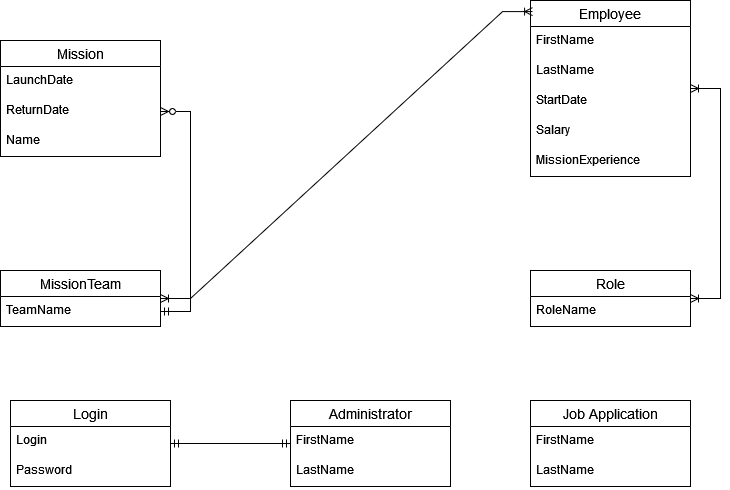

# 🚀 SpaceX Database & Mission Management Application

[](https://www.python.org/)
[](https://flask.palletsprojects.com/)
[](https://www.microsoft.com/sql-server)
[](LICENSE)

A full-stack web application designed for managing space missions, flight crews, scientific teams, and recruitment processes for SpaceX. Powered by a **Flask** backend and a robust **Microsoft SQL Server** relational database utilizing T-SQL views, stored procedures, and transactions.

---

## 📑 Table of Contents

- [Overview](#-overview)
- [Key Features](#-key-features)
- [Tech Stack](#-tech-stack)
- [Database Architecture](#-database-architecture)
- [Project Structure](#-project-structure)
- [Getting Started](#-getting-started)
  - [Prerequisites](#prerequisites)
  - [1. Database Setup](#1-database-setup)
  - [2. Application Setup](#2-application-setup)
  - [3. Running the App](#3-running-the-app)
- [Admin Access & Demo Credentials](#-admin-access--demo-credentials)
- [Screenshots & ERD](#-screenshots--erd)
- [License](#-license)

---

## 🌌 Overview

The **SpaceX Database Management App** bridges public-facing promotional & recruitment features with an internal administrative dashboard. It offers space enthusiasts and job applicants insight into upcoming missions, team rosters, and scientific achievements while giving administrators effortless control over mission planning, personnel hiring, and database records—without requiring manual SQL queries.

---

## ✨ Key Features

### 👨‍🚀 Public Portal
- **Dynamic Landing Page**: Showcases upcoming missions (*Mars*, *Moon*, *AroundEarth*), launch windows, and team assignments.
- **Mission Explorer (`/mission`)**: Browse planned space missions with dynamic sorting by launch date, return date, mission name, or team name.
- **Crew Roster (`/spaceman`)**: View astronauts and flight captains sorted by seniority, experience, salary, or start date.
- **Scientific Division (`/scientist`)**: Discover research personnel sorted by mission achievements and experience.
- **Career Portal (`/workwithus`)**: Interactive job application form allowing candidates to submit CV details directly into the database application pipeline.

### 🛡️ Administrative Portal (`/management`)
- **Admin Authentication**: Secure login system with encrypted password verification.
- **Personnel Management**: Add new employees, delete existing records, and update crew metrics.
- **Mission Management**: Create and schedule new space missions or remove completed/cancelled ones.
- **Application Processing & Automated Hiring**: One-click promotion of job candidates to active employees leveraging SQL Server stored procedures (`sp_MoveJobApplicationToEmployee`) with transactional integrity.

---

## 🛠️ Tech Stack

| Domain | Technology |
| :--- | :--- |
| **Backend Framework** | [Flask](https://flask.palletsprojects.com/) (Python) |
| **ORM & Database Driver** | [Flask-SQLAlchemy](https://flask-sqlalchemy.palletsprojects.com/), [pyodbc](https://mkleehammer.github.io/pyodbc/) |
| **Database Engine** | [Microsoft SQL Server](https://www.microsoft.com/sql-server) (T-SQL) |
| **Authentication & Security** | Flask-Login, Session Management, MD5 Hash Verification |
| **Frontend** | HTML5, CSS3 (Space Blue Theme), Jinja2 Templates, JavaScript |

---

## 🏛️ Database Architecture

The relational database (`SpaceX`) is designed for optimal performance, data integrity, and separation of concerns.

```
                  +-------------------+
                  |       Role        |
                  +-------------------+
                            |
        +-------------------+-------------------+
        |                                       |
+---------------+                       +---------------+
|   Employee    |                       | JobApplication|
+---------------+                       +---------------+
        |                                       |
+---------------+                       +---------------+
|  MissionTeam  |<--------------------->|    Mission    |
+---------------+ (MissionTeam_Employee)+---------------+
```

### Key Components:
- **Tables**: `Role`, `Employee`, `MissionTeam`, `MissionTeam_Employee`, `Mission`, `JobApplication`, `Login`, `Administrator`.
- **Views**:
  - `vw_CurrentMission`: Aggregates active mission details with assigned crew names and roles.
  - `vw_MissionsAndData`: Summarizes mission names, teams, and launch/return schedules.
  - `vw_SpacemanAndCaptains`: Filters personnel assigned as Captains or Spacemen.
  - `vw_Scientist`: Formats scientific staff information sorted by experience.
- **Stored Procedures**:
  - `sp_MoveJobApplicationToEmployee`: Atomically transfers a job candidate from `JobApplication` into `Employee`, assigns initial salary/experience, and removes the pending application inside a SQL transaction.

---

## 📁 Project Structure

```
Spacex-Database-App/
├── App/
│   ├── static/               # Static assets (CSS styles, images, logos)
│   ├── templates/            # Jinja2 HTML templates
│   │   ├── index.html        # Landing page
│   │   ├── mission.html      # Mission directory
│   │   ├── spaceman.html     # Astronauts roster
│   │   ├── scientist.html    # Scientists roster
│   │   ├── workwithus.html   # Recruitment page
│   │   ├── management.html   # Admin dashboard
│   │   └── login.html        # Authentication page
│   └── App.py                # Main Flask application & route definitions
├── docs/
│   └── SPECIFICATIONS.md     # Functional specification and requirements
├── schema.sql                # SQL script for database creation, tables & initial seed data
├── data.sql                  # SQL script for views, stored procedures & user permissions
├── ERD.png                   # Entity Relationship Diagram image
├── requirements.txt          # Python package dependencies
├── LICENSE                   # MIT License
└── README.md                 # Project documentation
```

---

## 🚀 Getting Started

### Prerequisites

Ensure you have the following installed on your machine:
- **Python 3.8+**
- **Microsoft SQL Server** (Local instance or Express)
- **ODBC Driver 17 for SQL Server**

### 1. Database Setup

1. Open **SQL Server Management Studio (SSMS)** or your preferred database client.
2. Run `schema.sql` to create the `SpaceX` database, tables, foreign key constraints, and default data:
   ```sql
   -- Executes schema.sql
   ```
3. Run `data.sql` to generate custom views, stored procedures, database roles, and user permissions:
   ```sql
   -- Executes data.sql
   ```

### 2. Application Setup

1. Clone this repository:
   ```bash
   git clone https://github.com/Karman1818/Spacex-Database-App.git
   cd Spacex-Database-App
   ```
2. Create and activate a virtual environment (optional but recommended):
   ```bash
   python -m venv venv
   # On Windows:
   venv\Scripts\activate
   # On macOS/Linux:
   source venv/bin/activate
   ```
3. Install required Python dependencies:
   ```bash
   pip install -r requirements.txt
   ```
4. Configure database connection parameters in `App/App.py` (or through environment variables):
   ```python
   server = os.getenv('DB_SERVER', r'localhost\SQLEXPRESS')
   database = os.getenv('DB_NAME', 'SpaceX')
   username = os.getenv('DB_USER', 'spacex_app_user')
   password = os.getenv('DB_PASSWORD', 'StrongPassword!123')
   ```

### 3. Running the App

Start the Flask development server:
```bash
python App/App.py
```
Open your browser and navigate to `http://127.0.0.1:5000`.

---

## 🔐 Admin Access & Demo Credentials

Pre-seeded administrator accounts (defined in `schema.sql`):

| Username | Password | Role |
| :--- | :--- | :--- |
| `3lon-m@sk` | `ILikeLetterX` | Administrator |
| `ManOfSt33l` | `HappyHogan` | Administrator |
| `b@tman` | `IronManSucks` | Administrator |

---

## 📸 Screenshots & ERD

### Entity Relationship Diagram (ERD)



*Full entity relationships and relational schema definitions across Missions, Payloads, Launch Sites, and Cores.*

---

## 📄 License

Distributed under the MIT License. See [LICENSE](LICENSE) for more information.
